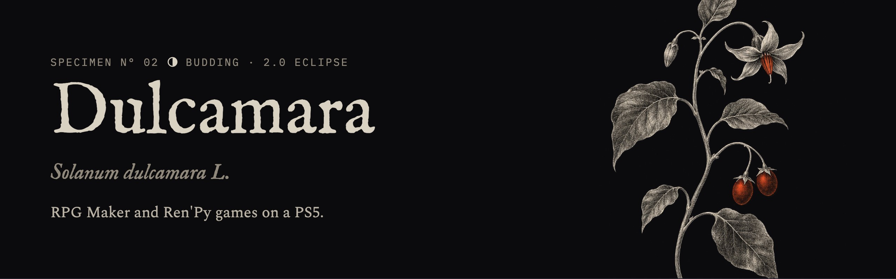

  

<h1 align="center">Dulcamara</h1>

  <strong>RPG Maker 2000 and 2003 games, and Ren'Py visual novels, on PS5 homebrew. Made for the controller, in Nightshade's black and red.</strong>

  
  
  
  
  

## Dulcamara Eclipse 2.1 PS5 test build

The test build includes the itch.io Shelf, support for compiled Python packages in Ren’Py 8 game archives, and the older Ren’Py 7 save API used by some games. Open **Settings → Library → Install itch.io Shelf**, then open the shelf from your library. This build uses the console’s existing access to `/data/dulcamara`.

Eclipse 2.1.2 can keep the interface readable with a missing fonts folder and use the title’s own storage if the console denies the shared library. [Storage and font repair notes](docs/releases/2.1.2.md)

The two reported Summertime Saga startup failures have host regression tests. Gameplay, controller input on hardware, and encrypted installation still need PS5 testing. The release includes the application ZIP, corresponding source and checksums. [Download the PS5 test build](https://github.com/Oliv3rmoon/Dulcamara/releases/tag/v2.1.2)

## Why Dulcamara

- **RPG Maker 2000 and 2003 games.** The original engines' events, battles, pictures and sound (MIDI, WAV, Ogg Vorbis and MP3), the Maniac Patch and the extensions the engine supports, and Japanese, Korean, Chinese, Cyrillic and Western games with their text in their own encoding.
- **Ren'Py visual novels** *(test release 0.2.3)*. Version 8.5 is built in (with Python 3.12 and FFmpeg for music, voice and movies), and 7.8 (with Python 2.7) for games made with 7 or 6; the library picks the one a game was made with. Cross moves the story on, Circle opens the game's menu, L1 and R1 roll back and forward, R2 fast-forwards and skips text already read, and the touchpad is the mouse. Only one game runs each time the app starts, so opening a second one starts the app again.
- **A library that finds your games.** Copy a game's folder (or a `.zip` / `.easyrpg` of it) and it shows up with its title and its own title screen as the cover. Sort by title or by the last played; Square looks for new games without restarting.
- **Made for the controller.** Cross confirms, Circle cancels, Triangle opens the game's menu, and every button can be mapped again in Settings. The touchpad opens Dulcamara's menu at any time. Hold R2 (or press it once) to fast-forward from x2 to x8, for grinding and long cutscenes.
- **CRT and LCD shaders.** CRT Royale, CRT Lottes, CRT Pi, Newpixie, Hyllian NTSC, Mattias, NTSC signals, LCD3x, zfast LCD and Game Boy LCD, or sharp square pixels, whole-number scaling and the game's own shape.
- **Updates from its own releases.** It asks this repository for a newer release and installs it, after checking `PPSA99010.zip` against the release's `SHA256SUMS`.
- **Free software, no bundled games.** Dulcamara remains under the GPL and includes no ads. Copy your own games or use the optional itch.io Shelf to download free Ren’Py titles. New insider builds require an eligible account; archived public builds keep their existing behavior.

## nightly insider

**New releases are now nightly insider only.** There will be no new public releases and no delayed public drop. This repository keeps the previously published source and downloads available as an archive. Eligible insiders receive new builds through [nightly insider](https://nightly-insider.nightly-ps5.workers.dev), with the matching source, build instructions and license notices. Existing licenses and recipients' source rights remain unchanged.

Join [nightly on Discord](https://discord.gg/pSqgRU3YP9), complete verification and the tester requirements, then sign in at [nightly insider](https://nightly-insider.nightly-ps5.workers.dev). Access depends on current eligibility and the release's testing window.

### What is coming

**Dulcamara Eclipse** is being built around a smoother, more reliable session: better game startup and cleanup, safer save handling, rendering fixes, a refreshed interface and new artwork. The focus is on making RPG Maker games and Ren'Py visual novels easier to start, play and return to.

## Install the PS5 test build

Extract the release ZIP and install the `PPSA99010` application folder using your existing Dulcamara homebrew installation method. The default library is `/data/dulcamara`. An accessible USB drive can host a separate library when its `dulcamara` folder contains a regular file named `portable.txt`. The release page has the console test steps and matching source.

## Docs

- **[Guide](docs/GUIDE.md):** [where games go](docs/GUIDE.md#where-games-go), [controls](docs/GUIDE.md#controls), [settings](docs/GUIDE.md#settings), [updates](docs/GUIDE.md#updates) and [building from source](docs/GUIDE.md#building-from-source).
- **[Changelog](docs/CHANGELOG.md)**, [Privacy policy](PRIVACY.md), [Third-party notices](THIRD_PARTY_NOTICES.md) and [Contributing](CONTRIBUTING.md).

## Requests, bugs and support

- **Ask for a fix or a feature:** [open an issue](https://github.com/Oliv3rmoon/Dulcamara/issues/new/choose), or ask in **[nightly on Discord](https://discord.gg/pSqgRU3YP9)**.
- **Bugs:** open an issue with `/data/dulcamara/logs/dulcamara.log`, copied right after the problem, and which game it was. Never attach games or their files.
- **A game that doesn't run right:** check it on a PC with the engine's own player first (see [Thanks](#thanks)); if it fails there too, that project's issues are the place.
- **If my work helps you,** you can [buy me a coffee](https://buymeacoffee.com/oliv3rmoon).

## The Nightshade family

Dulcamara is one of seven repositories in the Nightshade family, all by [Oliv3rmoon](https://github.com/Oliv3rmoon): the same black-and-red look, one Discord.

| App | What it is |
| --- | --- |
| [**Nightshade**](https://github.com/Oliv3rmoon/Nightshade) | The Switch emulator for PS5 homebrew |
| [**Physalis**](https://github.com/Oliv3rmoon/Physalis) | Live TV, movies and Plex on the PS5 |
| [**Datura**](https://github.com/Oliv3rmoon/Datura) | Game streaming from your PC to the PS5 |
| [**Mandrake**](https://github.com/Oliv3rmoon/Mandrake) | PS1 emulation, with two emulators |
| **Dulcamara** (this repo) | RPG Maker 2000 and 2003 games, and Ren'Py visual novels |
| [**Solanum**](https://github.com/Oliv3rmoon/Solanum) | A store for open-source PS5 homebrew, with its catalog [on the web](https://oliv3rmoon.github.io/Solanum-Catalog/) |
| [**Belladonna**](https://github.com/Oliv3rmoon/Belladonna) | Nightshade's PS5 Vulkan driver |

## Built on

[EasyRPG Player](https://easyrpg.org) for RPG Maker 2000 and 2003 games and [Ren'Py](https://www.renpy.org) for visual novels, on the frontend of [Mandrake](https://github.com/Oliv3rmoon/Mandrake).

## Thanks

Thanks to the testers in the nightly Discord who try every test build and send logs.

- **[EasyRPG](https://easyrpg.org)**, the team behind EasyRPG Player and liblcf, who made RPG Maker 2000
  and 2003 games playable everywhere as free software. Dulcamara only puts their work on the PS5;
  how well a game runs is theirs to credit. Check a game on EasyRPG Player on a PC first; if it fails
  there too, the [EasyRPG Player issues](https://github.com/EasyRPG/Player/issues) are the place.
- **[Ren'Py](https://www.renpy.org)**, by Tom Rothamel and the Ren'Py contributors, the visual novel
  engine built into the app as two cores (Ren'Py 8, and Ren'Py 7 for older games).
- **[Mandrake (formerly Nightshade Station)](https://github.com/Oliv3rmoon/Mandrake)** and the work it is made of:
  **[SwanStationPS5](https://github.com/darkxex/SwanStationPS5)** by **darkxex**, whose frontend this is,
  **[PSXS5](https://github.com/SynoPiia/PSXS5)** by **SynoPiia**, and **BlackBearReloaded**'s
  ps5-native-app-boilerplate.
- **[ps5-payload-dev](https://github.com/ps5-payload-dev)** for the SDK and PacBrew, **Mihawk-99** for the
  RADV port, and everyone in [THIRD_PARTY_NOTICES.md](THIRD_PARTY_NOTICES.md).

## License

Dulcamara is free software under the GNU General Public License, version 3 or later
([LICENSE](LICENSE)). EasyRPG Player is GPL-3.0-or-later and liblcf MIT; Ren'Py is MIT, with
LGPL-derived parts; every component keeps its own licence, listed in
[THIRD_PARTY_NOTICES.md](THIRD_PARTY_NOTICES.md), and the app folder carries their texts in `licenses/`.

## Disclaimer

Dulcamara is an unofficial project: neither the EasyRPG team, the Ren'Py project, Enterbrain / Kadokawa nor
Sony endorse it. RPG Maker is a trademark of its owners. No game, RTP, key or system file is included or
downloaded: use games you have the right to play.

## Help it grow

Like Dulcamara? **[Star it](https://github.com/Oliv3rmoon/Dulcamara)** and **[join the Discord](https://discord.gg/pSqgRU3YP9)**.
