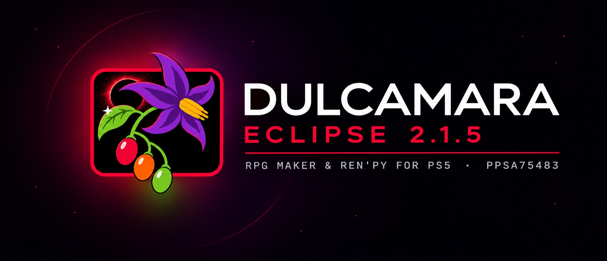
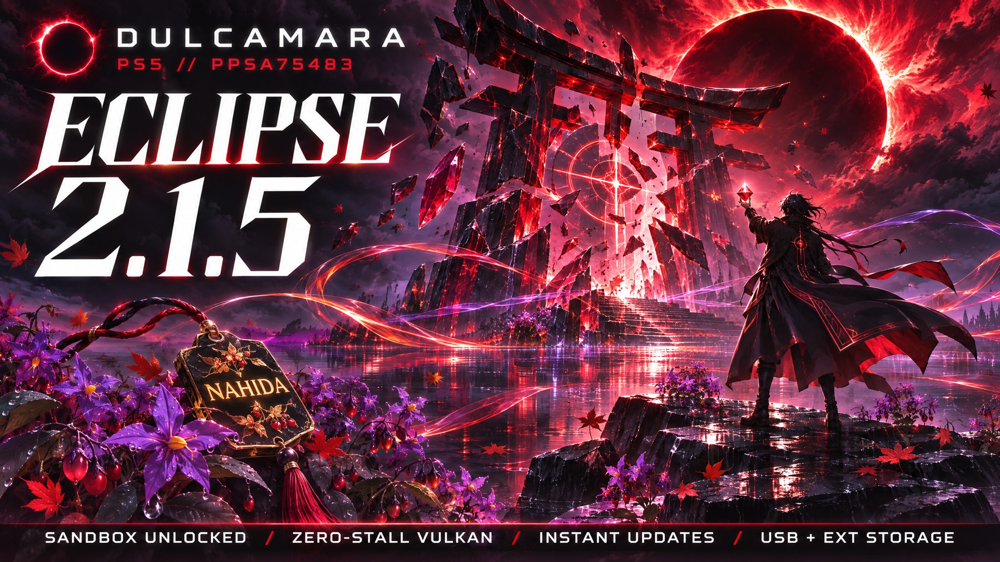
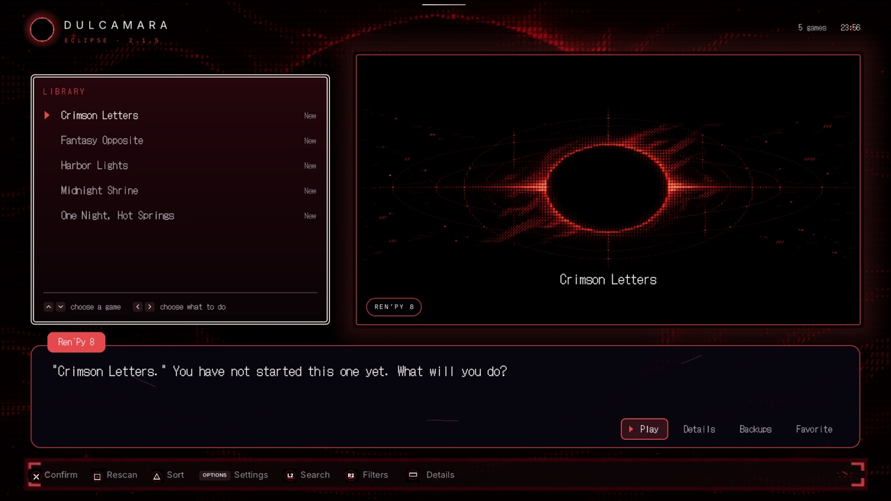
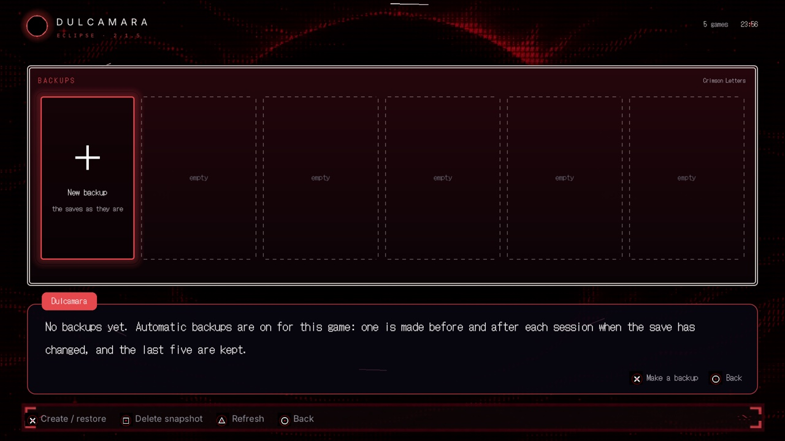
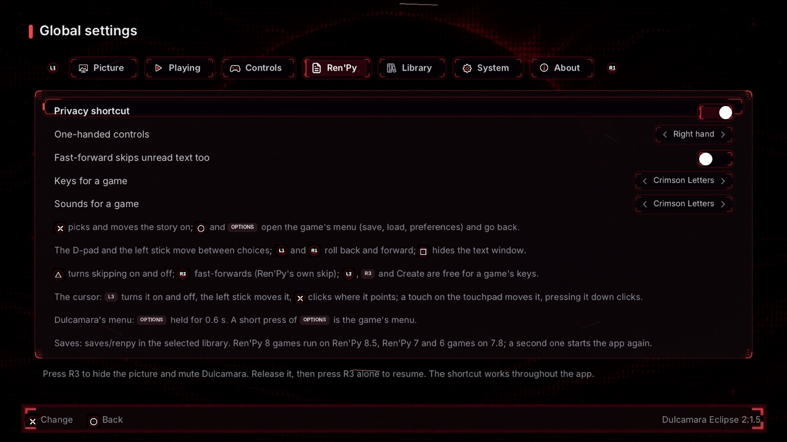

  

  <strong>RPG Maker 2000/2003 games and Ren'Py visual novels on PS5 — built for a DualSense, a couch, and a big screen.</strong>

  
  
  
  

  <a href="https://github.com/Oliv3rmoon/Dulcamara/releases/tag/v2.1.5"><strong>Download Eclipse 2.1.5 (PS5)</strong></a> ·
  <a href="https://github.com/Oliv3rmoon/Dulcamara/releases">All releases</a> ·
  <a href="https://discord.gg/pSqgRU3YP9">Join nightly</a>

---

  

> [!NOTE]
> **Dulcamara Eclipse 2.1.5 (`PPSA75483`)** is out as a PS5 test build. It restores startup `/data` unlock (with a dedicated `PPSA75483` `lapy.elf` helper), moves CPU-rendered Ren'Py & EasyRPG frames onto a persistent ring-buffered Vulkan image to eliminate black flashes, saves settings immediately on toggle, fixes updater lockouts, and extends portable libraries to `/mnt/ext0`–`/mnt/ext1`. Host tests and upgrade checks have passed; physical PS5 verification is ongoing. Grab **[PPSA75483.zip](https://github.com/Oliv3rmoon/Dulcamara/releases/download/v2.1.5/PPSA75483.zip)** (with [matching source](https://github.com/Oliv3rmoon/Dulcamara/releases/download/v2.1.5/Dulcamara-Eclipse-2.1.5-source.tar.zst) and [SHA-256 sums](https://github.com/Oliv3rmoon/Dulcamara/releases/download/v2.1.5/SHA256SUMS)) and share console reports in [nightly](https://discord.gg/pSqgRU3YP9).

  
  
  

Story mode, automatic save backups, and Ren'Py couch controls — captured from Dulcamara Eclipse 2.1.5's host preview with sample titles.

## What's inside

- **Story mode & Shelf view.** Browse your library like a classic RPG menu with a visual-novel dialogue box, or switch back to the cover shelf anytime in `Settings → Library`.
- **Ren'Py 8, 7 & 6 + RPG Maker 2000/2003 in one app.** Drop a game folder or `.zip` into `games/` and Dulcamara picks the right engine automatically — Ren'Py 8.5 (Python 3.12 + FFmpeg), Ren'Py 7.8 (Python 2.7), or EasyRPG Player (Maniac Patch + Japanese, Korean, Chinese, Cyrillic, and Western encodings).
- **itch.io from the couch.** Install the bundled **itch.io Shelf 1.1** from `Settings → Library` to browse and install free Ren'Py games straight on PS5, or queue direct `.zip` links through `links.txt` or the on-screen keyboard.
- **One-handed controls & instant privacy.** Play visual novels with standard bindings or switch to **Left-hand** / **Right-hand** mode (`Settings → Ren'Py`). Press **R3** anywhere in the app to hide the screen, pause the game, and mute audio. Includes touchpad mouse, R2 fast-forward (x2–x8), per-game key remapping, and per-game sound muting.
- **Zero-stall Vulkan & classic shaders.** Persistent ring-buffered Vulkan frames keep 1080p Ren'Py clean even with shaders off — or layer on CRT Royale, CRT Lottes, CRT Pi, Newpixie, Hyllian NTSC, LCD3x, zfast LCD, or sharp integer scaling.
- **Saves you don't lose.** Five automatic snapshots per game, a verified recovery copy before every restore, and reset-safe portable libraries (`dulcamara/portable.txt`) on USB or extended storage (`/mnt/ext0`, `/mnt/ext1`).
- **Its own slot (`PPSA75483`).** Dedicated PS5 title ID beside vkQuake and every other Nightshade app, single-threaded `/data` unlock via etaHEN / LegacyJB / OnionHEN or the bundled `lapy.elf` helper, live storage diagnostics in `Settings → About`, and SHA-256-verified in-app updates.

## Install

1. Download **`PPSA75483.zip`** from the [Eclipse 2.1.5 release](https://github.com/Oliv3rmoon/Dulcamara/releases/tag/v2.1.5) and extract it.
2. Copy the **`PPSA75483`** folder to `/data/homebrew/` on your PS5 over FTP and set permissions to `777` recursively. *(If you have an older `PPSA99010` folder or vkQuake installed, leave it untouched.)*
3. Restart ShadowMountPlus (or the console) and open **Dulcamara Eclipse** from the home screen.
4. Copy your RPG Maker or Ren'Py game folders (or `.zip` archives) into `/data/dulcamara/games/`, then press **Square** to scan.

> [!TIP]
> **Keep your library off internal storage (USB or extended drive):** extract [`Dulcamara-USB-library.zip`](https://github.com/Oliv3rmoon/Dulcamara/releases/download/v2.1.5/Dulcamara-USB-library.zip) to the root of one USB or extended drive (creating `dulcamara/portable.txt` and `dulcamara/games/`), connect it, and press **Square** in the library.

Controls quick reference

| Context | Input | Action |
| --- | --- | --- |
| **Library** | `Cross` / `Square` / `Triangle` / `OPTIONS` | Open game · Rescan / retry storage · Sort · Settings |
| **RPG Maker** | `Cross` / `Circle` / `Triangle` / `Touchpad` | Decision · Cancel · Game menu · Dulcamara menu |
| **Ren'Py** | `Cross` / `Circle` / `L1` `R1` / `Square` | Advance · Game menu & back · Rollback / forward · Hide text |
| **Ren'Py** | `L3` / `Touchpad` / `R2` / Hold `OPTIONS` | Toggle cursor · Move & click · Fast-forward · Dulcamara menu |
| **Anywhere** | `R3` *(when enabled in `Settings → Ren'Py`)* | Hide picture, pause gameplay, and mute audio |

Docs, bugs & building from source

- **[Guide](docs/GUIDE.md):** where games go, controls, settings, updates, and building from source.
- **[Changelog](docs/CHANGELOG.md)** · [Privacy policy](PRIVACY.md) · [Third-party notices](THIRD_PARTY_NOTICES.md) · [Contributing](CONTRIBUTING.md)
- **Bug reports & requests:** [open an issue](https://github.com/Oliv3rmoon/Dulcamara/issues/new/choose) or drop by [nightly on Discord](https://discord.gg/pSqgRU3YP9). Attach `/data/dulcamara/logs/dulcamara.log` (never attach games).

## The Nightshade family

Seven PS5 homebrew repositories by **[Oliv3rmoon](https://github.com/Oliv3rmoon)** — one visual language, one Discord.

| App | What it does |
| --- | --- |
| [**Nightshade**](https://github.com/Oliv3rmoon/Nightshade) | Switch emulation on PS5 homebrew |
| [**Dulcamara**](https://github.com/Oliv3rmoon/Dulcamara) | RPG Maker 2000/2003 games and Ren'Py visual novels *(this repo)* |
| [**Mandrake**](https://github.com/Oliv3rmoon/Mandrake) | PlayStation 1 emulation with dual cores |
| [**Physalis**](https://github.com/Oliv3rmoon/Physalis) | Live TV, movies, and Plex on PS5 |
| [**Datura**](https://github.com/Oliv3rmoon/Datura) | PC game streaming to PS5 |
| [**Solanum**](https://github.com/Oliv3rmoon/Solanum) | Open-source PS5 homebrew store ([web catalog](https://oliv3rmoon.github.io/Solanum-Catalog/)) |
| [**Belladonna**](https://github.com/Oliv3rmoon/Belladonna) | Nightshade's PS5 Vulkan (RADV) driver |

## Credits & license

Built on **[EasyRPG Player](https://easyrpg.org)** & **liblcf**, **[Ren'Py](https://www.renpy.org)** (8.5 & 7.8), **[Mandrake](https://github.com/Oliv3rmoon/Mandrake)** (**darkxex**'s SwanStationPS5, **SynoPiia**'s PSXS5, **BlackBearReloaded**'s ps5-native-app-boilerplate), **[ps5-payload-dev](https://github.com/ps5-payload-dev)**, and **Mihawk-99**'s RADV port. Huge thanks to **Nahida** and the testers in [nightly](https://discord.gg/pSqgRU3YP9) who test builds, catch edge cases, and send logs.

Free software under **[GPL-3.0-or-later](LICENSE)**. Every bundled component keeps its own license in [THIRD_PARTY_NOTICES.md](THIRD_PARTY_NOTICES.md) and inside the app's `licenses/` folder. No games, RTPs, or system files are included or downloaded; play games you have the right to use. Unofficial project — not affiliated with EasyRPG, Ren'Py, Enterbrain/Kadokawa, or Sony.

   
  If Dulcamara works for you, a ⭐ helps other PS5 owners find it.

